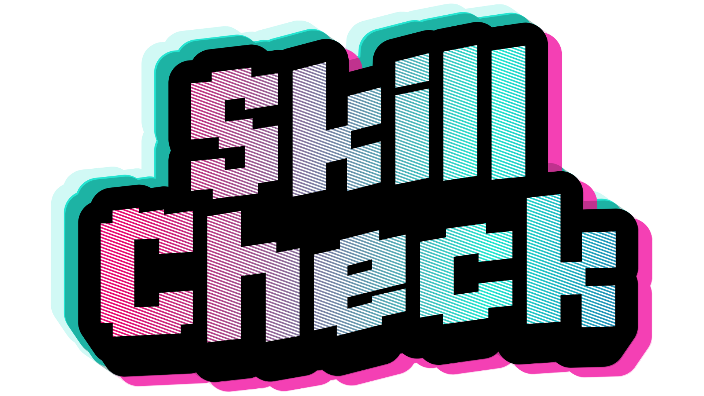

# DigitalMedia-Group7

# Sprites
* all sprites already made are in the sprites folder
   - logo
   - menu buttons (options and main)
   - "some" sprites for Bullet Hell (character, projectiles, background)
   - style guide is in discord and has colors (w/ hex codes) and the font used for logo and most likely for rest of game
* more will be added as needed

# Code
* code will be submitted into the code folder

# Unity Builds
* builds will be submitted into this folder

  this readme will be updated as needed
